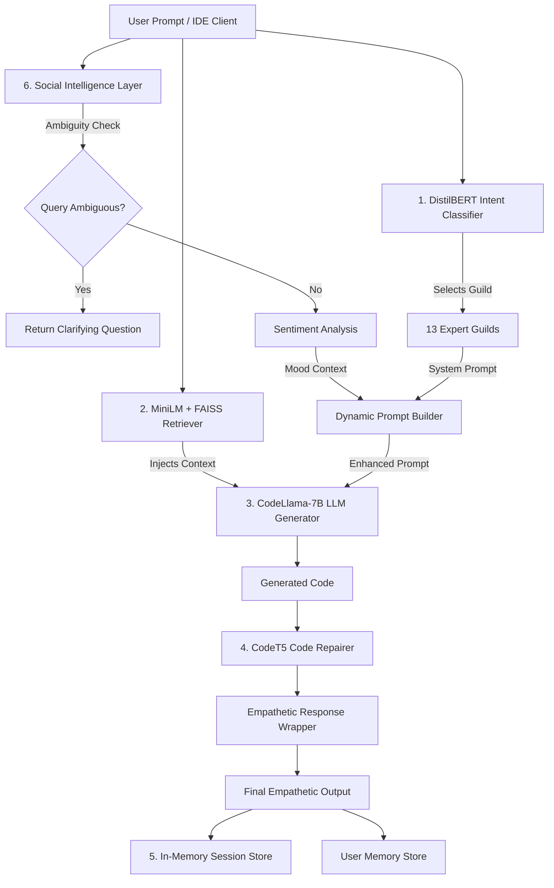

# CONCODE Neural Brain — Master Dashboard

> Heavy-Neuron Cognitive Engine with 7 Billion+ Parameters, 13 Expert Guilds, and 6 Neural Subsystems running locally on Apple Silicon with Metal GPU acceleration.

---

## System Interactive Canvas Map

> Open the visual canvas mapping file: [[CONCODE-Neural-Brain-Map.canvas]]

---

## 6 Neural Subsystems

| # | Subsystem | Model / Tech | Parameters | Role | Note Link |
|---|-----------|--------------|------------|------|-----------|
| **1** | **Intent Classifier** | DistilBERT | 66M | Routes queries to 13 expert guilds | [[01-Brain-Architecture/01-Intent-Classifier|01-Intent-Classifier]] |
| **2** | **Workspace Retriever** | MiniLM + FAISS | 22M | Injects relevant workspace context | [[01-Brain-Architecture/02-Workspace-Retriever|02-Workspace-Retriever]] |
| **3** | **Core LLM Generator** | CodeLlama-7B (GGUF) | 7,000,000,000+ | Generates guild-specialized code | [[01-Brain-Architecture/03-Core-LLM-Generator|03-Core-LLM-Generator]] |
| **4** | **Code Repairer** | CodeT5-small | 60M | Self-heals syntax errors and typos | [[01-Brain-Architecture/04-Code-Repairer|04-Code-Repairer]] |
| **5** | **Session Memory** | In-Memory Store | -- | Maintains multi-turn conversation context | [[01-Brain-Architecture/05-Session-Memory|05-Session-Memory]] |
| **6** | **Social Intelligence** | DistilBERT SST-2 + JSON Store | 66M | Sentiment, user memory, dynamic prompts, ambiguity, empathy | [[01-Brain-Architecture/09-Social-Intelligence|09-Social-Intelligence]] |

---

## 13 Expert Guilds (MoE Routing)

> Complete guild documentation: [[02-Guilds/Guild-Overview|Guild-Overview]]

| Guild Name | Primary Domain | Status | Note Link |
|------------|----------------|:------:|-----------|
| **Debugger** | Runtime errors, stack traces, null checks | Ready | [[02-Guilds/Debugger-Guild|Debugger-Guild]] |
| **WebGL** | Three.js, GLSL shaders, 3D scenes | Ready | [[02-Guilds/WebGL-Guild|WebGL-Guild]] |
| **AI / ML** | PyTorch, Transformers, RAG, Quantization | Ready | [[02-Guilds/AI-ML-Guild|AI-ML-Guild]] |
| **QA** | Jest, Cypress, pytest, TDD unit testing | Ready | [[02-Guilds/QA-Guild|QA-Guild]] |
| **Security** | JWT, OAuth2, XSS/SQLi defense, OWASP | Ready | [[02-Guilds/Security-Guild|Security-Guild]] |
| **Performance** | Latency reduction, memoization, Web Workers | Ready | [[02-Guilds/Performance-Guild|Performance-Guild]] |
| **Database** | SQL DDL, indexes, ORMs, migration scripts | Ready | [[02-Guilds/Database-Guild|Database-Guild]] |
| **UI / UX** | Responsive CSS, animations | Ready | [[02-Guilds/UI-UX-Guild|UI-UX-Guild]] |
| **DevOps** | Docker, Kubernetes, CI/CD, Nginx, Terraform | Ready | [[02-Guilds/DevOps-Guild|DevOps-Guild]] |
| **API** | FastAPI, Express REST, GraphQL, WebSockets | Ready | [[02-Guilds/API-Guild|API-Guild]] |
| **Fullstack** | Generalist system architecture (Default) | Ready | [[02-Guilds/Fullstack-Guild|Fullstack-Guild]] |
| **Mobile** | Mobile iOS/Android development | Ready | [[02-Guilds/Mobile-Guild|Mobile-Guild]] |
| **Blockchain** | Web3 smart contracts & Solana programs | Ready | [[02-Guilds/Blockchain-Guild|Blockchain-Guild]] |

---

## Datasets & Training Pipelines

- Data Generator: [[03-Training-Data/Data-Pipeline|Data-Pipeline]] (`src/generate_data.py`)
- Intent Dataset: [[03-Training-Data/Intent-Dataset|Intent-Dataset]] (5,500 examples, 13 classes)
- Instruction Dataset: [[03-Training-Data/Multi-Guild-Train|Multi-Guild-Train]] (5,500 multi-guild training prompts)
- Repair Dataset: [[03-Training-Data/Repair-Dataset|Repair-Dataset]] (10,000 code repair pairs)
- QLoRA Fine-Tuning: [[04-Experiments/QLoRA-FineTuning|QLoRA-FineTuning]] (224 LoRA matrices, `r=64`, `α=128`)
- GGUF Quantization: [[04-Experiments/GGUF-Quantization|GGUF-Quantization]] (FP16 -> Q4_K_M for Apple Metal GPU)

---

## API & Integration Infrastructure

- FastAPI Engine: [[01-Brain-Architecture/06-FastAPI-Service|06-FastAPI-Service]] (`src/service.py`)
- Client Integration: [[01-Brain-Architecture/07-Client-Integration|07-Client-Integration]] (`integration/concode_brain_client.js`)
- Kaggle GPU Deployment: [[12-Infrastructure/04-Kaggle-GPU-Deployment|04-Kaggle-GPU-Deployment]] (Cloud GPU host + Cloudflare tunnel)
- TripVerse AI Planner Bridge: [[14-Client-SDK/04-TripVerse-AI-Planner-Bridge|04-TripVerse-AI-Planner-Bridge]] (`src/services/aiTripPlanner.ts`)
- Session Tracking: [[05-Session-Logs/Session-Tracking|Session-Tracking]]

---

## System MOCs & Architecture Hubs

- Architecture Overview: [[01-Brain-Architecture/00-Brain-Overview|00-Brain-Overview]]
- Thinking Skills MOC: [[07-Thinking-Skills/Thinking-Skills-MOC|Thinking-Skills-MOC]] (55 Granular Thinking Skills)
- Decision Graphs MOC: [[08-Decision-Graphs/Decision-Graphs-MOC|Decision-Graphs-MOC]] (4 Flowchart Decision Trees)
- System Benchmarks MOC: [[10-Benchmarks/Benchmarks-MOC|Benchmarks-MOC]] (Latency, VRAM, Repair Accuracy)
- Expert Guilds MOC: [[02-Guilds/Guild-Overview|Guild-Overview]] (13 Expert Personas)
