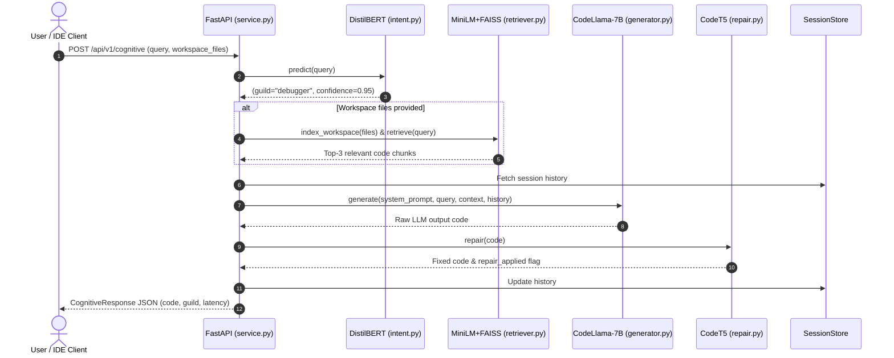

# CONCODE Neural Brain Overview

> **Heavy-neuron cognitive engine** powered by **7 Billion+ Parameters**, 13 expert guilds, and 6 neural subsystems -- executing locally on Apple Silicon with Metal GPU acceleration.

---

## Interactive Canvas Visual Map

>  Open native visual map: **[[CONCODE-Neural-Brain-Map.canvas]]** ---

## High-Level System Architecture

```
┌────────────────────────────────────────────────────────────────────────┐
│                          CONCODE Neural Brain                          │
│                                                                        │
│   ┌───────────────┐     ┌────────────────┐     ┌───────────────────┐   │
│   │  DistilBERT   │     │ MiniLM + FAISS │     │   CodeLlama-7B    │   │
│   │ Intent Class. │───> │   Retriever    │───> │  (GGUF / Metal)   │   │
│   │  (66M params) │     │  (Workspace)   │     │    (7B params)    │   │
│   └───────────────┘     └────────────────┘     └─────────┬─────────┘   │
│           │                                              │             │
│           │ Routes to Guild                              │             │
│           ▼                                              ▼             │
│   ┌───────────────┐                            ┌───────────────────┐   │
│   │ 11 Expert     │                            │      CodeT5       │   │
│   │ Guilds (MoE)  │──────────────────────────> │   Code Repair     │   │
│   └───────────────┘                            └───────────────────┘   │
└────────────────────────────────────────────────────────────────────────┘
```

---

## The 6 Neural Subsystems

The cognitive engine operates as a multi-stage pipeline across 6 distinct neural subsystems:

1. **Intent Classifier** ([[01-Brain-Architecture/01-Intent-Classifier|01-Intent-Classifier]]): Uses a fine-tuned DistilBERT (66M params) to route user queries into 1 of 13 domain guilds. Falls back to keyword matching if the neural model is absent.
2. **Workspace Retriever** ([[01-Brain-Architecture/02-Workspace-Retriever|02-Workspace-Retriever]]): Uses `all-MiniLM-L6-v2` embeddings and FAISS index search to chunk workspace files and retrieve relevant code snippets.
3. **Core LLM Generator** ([[01-Brain-Architecture/03-Core-LLM-Generator|03-Core-LLM-Generator]]): Executes CodeLlama-7B GGUF (`Q4_K_M`) via `llama-cpp-python` offloading all 32 transformer layers to the Apple Silicon Metal GPU (`-ngl 99`).
4. **Code Repairer** ([[01-Brain-Architecture/04-Code-Repairer|04-Code-Repairer]]): Uses fine-tuned CodeT5-small (60M params) to detect and fix syntax errors, missing brackets, and typos.
5. **Session Memory** ([[01-Brain-Architecture/05-Session-Memory|05-Session-Memory]]): Maintains stateful conversation context for up to 3 turns per session ID.
6. **Social Intelligence** ([[01-Brain-Architecture/09-Social-Intelligence|09-Social-Intelligence]]): Adds human-like social awareness through sentiment analysis (DistilBERT SST-2), persistent user memory, dynamic prompt building, ambiguity detection, and empathetic response wrapping.

---

## Parameter & Compute Matrix

| Subsystem Component | Model | Parameters | Layer Count | Hardware Target |
|---------------------|-------|------------|-------------|-----------------|
| **Intent Classification** | DistilBERT-base | 66,000,000 | 6 Transformer | CPU / MPS |
| **Vector Embedder** | MiniLM-L6-v2 | 22,000,000 | 6 Transformer | CPU / MPS |
| **Core Generation LLM** | CodeLlama-7B | 6,738,415,616 | 32 Transformer | Metal GPU (32/32) |
| **QLoRA Adapters** | Custom 11-Guild | ~160,000,000 | 224 Adapters | Integrated in LLM |
| **Neural Code Repair** | CodeT5-small | 60,000,000 | 6 Enc / 6 Dec | CPU / MPS |
| **Sentiment Analyzer** | DistilBERT SST-2 | 66,000,000 | 6 Transformer | CPU / MPS |
| **Total Engine Weight** | **Integrated** | **~7,112,000,000** | **50 Layers** | **Apple Metal GPU** |

---

## Cognitive Execution Flow



---

## Related Notes

- Back to Dashboard: [[00-Dashboard/Dashboard|Dashboard]]
- Intent Subsystem: [[01-Brain-Architecture/01-Intent-Classifier|01-Intent-Classifier]]
- Retriever Subsystem: [[01-Brain-Architecture/02-Workspace-Retriever|02-Workspace-Retriever]]
- Generator Subsystem: [[01-Brain-Architecture/03-Core-LLM-Generator|03-Core-LLM-Generator]]
- Code Repair Subsystem: [[01-Brain-Architecture/04-Code-Repairer|04-Code-Repairer]]
- Session Memory Subsystem: [[01-Brain-Architecture/05-Session-Memory|05-Session-Memory]]
- Social Intelligence: [[01-Brain-Architecture/09-Social-Intelligence|09-Social-Intelligence]]
- API Service Interface: [[01-Brain-Architecture/06-FastAPI-Service|06-FastAPI-Service]]
- Expert Guild Routing: [[02-Guilds/Guild-Overview|Guild-Overview]]
