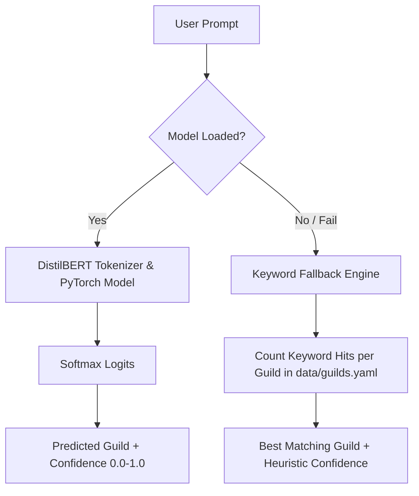

# Subsystem 1: Intent Classifier

> **DistilBERT fine-tuned on 11 guild classes** with intelligent keyword matching fallback.

---

## Overview

The **Intent Classifier** acts as the front door of the CONCODE Neural Brain cognitive pipeline. It analyzes the user's natural language request and assigns it to one of the 11 [[Guild-Overview|Expert Guilds]], returning both the selected guild name and a confidence score.

- **File Source**: [`src/brain/intent.py`](file:///Users/ms/Desktop/CONCODE_BRAIN/src/brain/intent.py)
- **Class**: `IntentClassifier`
- **Model Architecture**: DistilBERT (`distilbert-base-uncased`)
- **Number of Classes**: 11
- **Max Input Length**: 128 tokens

---

## How It Works

### 1. Neural Prediction Path (`_predict_neural`)
1. Tokenizes `text` using `AutoTokenizer` (max length 128, truncated/padded).
2. Runs forward pass through `AutoModelForSequenceClassification`.
3. Applies `torch.softmax` to output logits to compute class probabilities.
4. Returns `(guild_name, confidence)`.

### 2. Keyword Fallback Path (`_predict_keyword`)
If the PyTorch model directory (`models/intent_classifier/`) does not contain `config.json`, the subsystem automatically falls back to keyword matching:
1. Loads keyword lists from [`data/guilds.yaml`](file:///Users/ms/Desktop/CONCODE_BRAIN/data/guilds.yaml).
2. Counts occurrences of guild keywords in lowercased user prompt.
3. Selects guild with highest keyword match count.
4. Calculates heuristic confidence: `min(0.5 + (matches * 0.1), 0.85)` or `0.3` default.

---

## Performance Metrics

- **Training Dataset**: [[Intent-Dataset]] (5,500 synthetic examples across 11 classes)
- **Inference Latency**: ~8ms on CPU / Apple MPS
- **Fallback Threshold**: Defaults to `fullstack` guild if no keywords or neural output matches.

---

## Related Notes

- Architecture Overview: [[00-Brain-Overview]]
- Next Pipeline Step: [[02-Workspace-Retriever]]
- Guild Routing Index: [[Guild-Overview]]
- Dataset Details: [[Intent-Dataset]]
- Config File: [[06-FastAPI-Service]]
