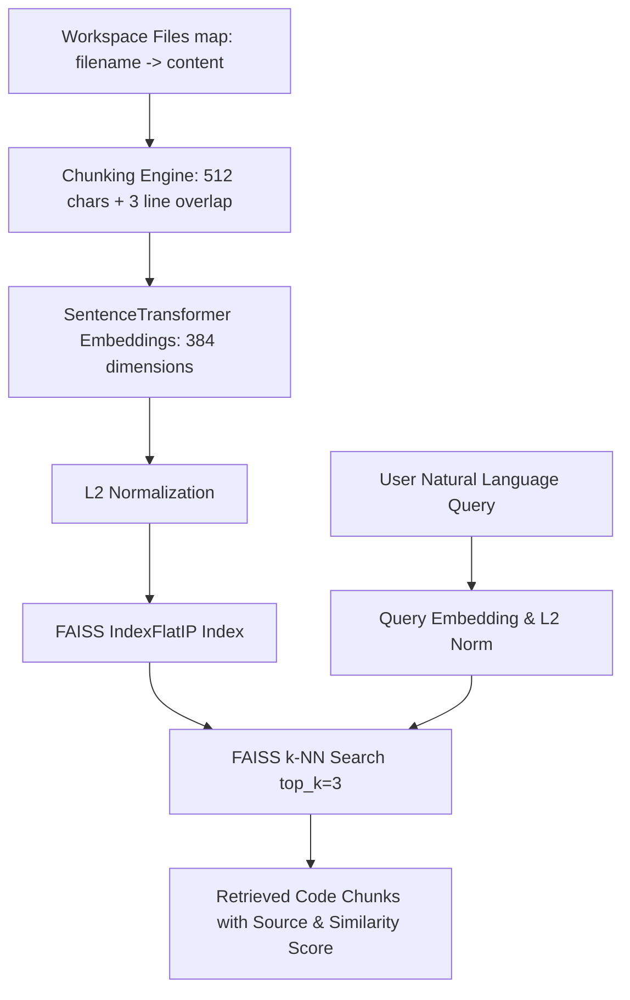

# Subsystem 2: Workspace Retriever

> **Sentence-Transformers (`all-MiniLM-L6-v2`) + FAISS** vector similarity engine for real-time context retrieval.

---

## Overview

The **Workspace Retriever** provides Retrieval-Augmented Generation (RAG) capabilities to the CONCODE Neural Brain. It indexes open files sent from the user's IDE editor, chunks them, computes dense vector embeddings, and retrieves the most relevant code sections for injection into the core LLM prompt.

- **File Source**: [`src/brain/retriever.py`](file:///Users/ms/Desktop/CONCODE_BRAIN/src/brain/retriever.py)
- **Class**: `WorkspaceRetriever`
- **Embedding Model**: `all-MiniLM-L6-v2` (384 dimensions)
- **Vector Index**: FAISS Inner Product (`IndexFlatIP` on $L_2$ normalized vectors = Cosine Similarity)
- **Chunking Strategy**: 512 characters per chunk with 3-line overlap

---

## How It Works



### 1. File Chunking (`_chunk_text`)
- Iterates line by line.
- Constructs chunks of maximum ~512 characters.
- Maintains context continuity across boundaries by carrying over the last 3 lines to the next chunk.

### 2. Vector Indexing (`index_workspace`)
1. Generates 384-dimensional dense vectors for each text chunk using `SentenceTransformer`.
2. Normalizes vectors using `faiss.normalize_L2`.
3. Creates a flat inner-product index (`IndexFlatIP`) for exact inner product calculation (equivalent to cosine similarity).

### 3. Similarity Search (`retrieve`)
1. Encodes the user's prompt query into a 384-dim vector.
2. Normalizes query vector and searches `FAISS` index for `top_k=3` nearest neighbors.
3. Formats matches with source filename, similarity score (0.0 – 1.0), and text snippet.

---

## Sample Retrieved Output Format

```javascript
// --- src/auth.js (score: 0.8742) ---
async function verifyToken(token) {
  const decoded = jwt.verify(token, process.env.JWT_SECRET);
  return decoded;
}
```

---

## Related Notes

- Architecture Overview: [[00-Brain-Overview]]
- Previous Pipeline Step: [[01-Intent-Classifier]]
- Next Pipeline Step: [[03-Core-LLM-Generator]]
- Client Integration: [[07-Client-Integration]]
