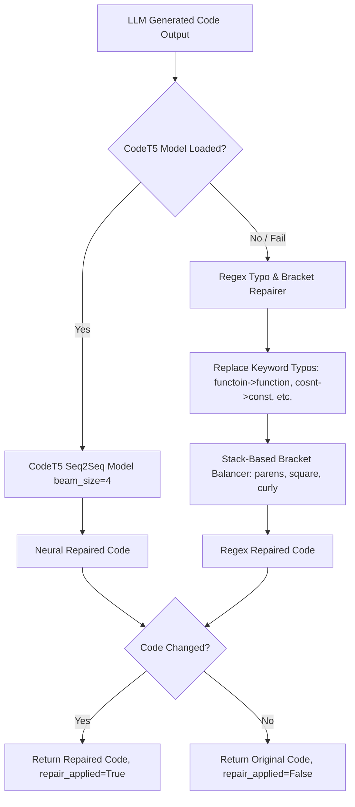

# Subsystem 4: Code Repairer

> **CodeT5-small Seq2Seq Neural Model** + regex-based fallback engine for **self-healing code generation**.

---

## Overview

The **Code Repairer** is the quality guardrail of the CONCODE Neural Brain. It receives raw code outputs from the [[03-Core-LLM-Generator]], scans for syntax flaws, missing brackets, or typographical mistakes, and automatically repairs them before passing the response back to the client.

- **File Source**: [`src/brain/repair.py`](file:///Users/ms/Desktop/CONCODE_BRAIN/src/brain/repair.py)
- **Class**: `CodeRepairer`
- **Neural Model**: `CodeT5-small` (60M parameters) or `CodeT5-base` (220M parameters)
- **Task**: Sequence-to-Sequence code repair (`fix: <broken_code>` → `<repaired_code>`)
- **Fallback Engine**: Pattern-matching regex & stack-based bracket balancer

---

## Repair Architecture

---

## Typo & Bracket Balancing Engine (`_repair_regex`)

The regex fallback handles common LLM hallucination and typing errors:

### 1. Keyword Typo Map
- `functoin`, `fucntion`, `funciton` → `function`
- `retun`, `retrun`, `reutrn` → `return`
- `cosnt`, `conts` → `const`
- `ipmort` → `import`, `exoprt` → `export`
- `consol.log`, `consoel.log` → `console.log`
- `udnefined` → `undefined`, `lenght` → `length`

### 2. Stack-Based Bracket Balancer (`_balance_brackets`)
Scans characters maintaining an explicit stack for `(`, `[`, `{`. Appends missing closing brackets at the end of the string if unbalanced.

---

## Dataset & Metrics

- **Training Dataset**: [[Repair-Dataset]] (10,000 paired examples of broken vs fixed code)
- **Repair Applied Flag**: Sent in `CognitiveResponse.repair_applied` boolean for IDE notifications.

---

## Related Notes

- Architecture Overview: [[00-Brain-Overview]]
- Previous Pipeline Step: [[03-Core-LLM-Generator]]
- Next Pipeline Step: [[05-Session-Memory]]
- Repair Dataset Analysis: [[Repair-Dataset]]
