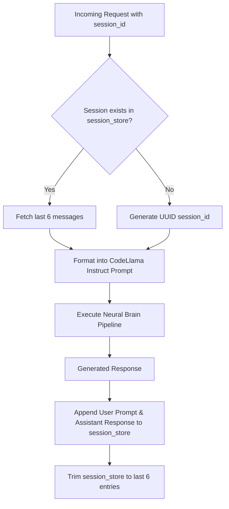

# Subsystem 5: Session Memory

> **Stateful in-memory conversation store** providing multi-turn context awareness to the cognitive engine.

---

## Overview

The **Session Memory** subsystem retains previous conversation turns per session UUID. This allows users to ask follow-up questions (e.g. *"Now add tests for this function"*) without re-pasting prior context.

- **File Source**: [`src/service.py`](file:///Users/ms/Desktop/CONCODE_BRAIN/src/service.py#L85)
- **Data Structure**: `defaultdict(list)` mapping `session_id` → `List[Dict[str, str]]`
- **History Boundary**: Keeps the last **3 conversation turns** (up to 6 message objects: 3 `user`, 3 `assistant`)

---

## Workflow & Data Structures



---

## Message Schema Example

```json
{
  "session_id": "b3e94a11-8f2b-4e69-921a-7952a10b4291",
  "history": [
    {
      "role": "user",
      "content": "Create a FastAPI endpoint for user login."
    },
    {
      "role": "assistant",
      "content": "@app.post('/login')\nasync def login(credentials: UserCredentials): ..."
    },
    {
      "role": "user",
      "content": "Now add JWT authentication middleware to it."
    }
  ]
}
```

---

## Related Notes

- Architecture Overview: [[00-Brain-Overview]]
- Generator Formatting: [[03-Core-LLM-Generator]]
- Service Handler: [[06-FastAPI-Service]]
- Client Integration: [[07-Client-Integration]]
- Session Logs: [[Session-Tracking]]
