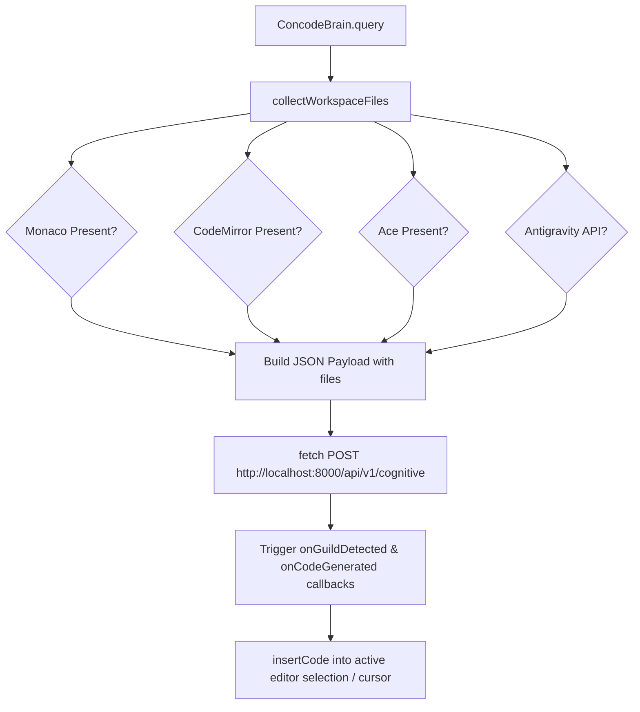

# Client Integration & Website Client SDK

> Drop-in JavaScript integration module (`ConcodeBrain`) for websites, Monaco, CodeMirror, Ace, and Antigravity editors.

---

## Overview

The **Client Integration SDK** allows any frontend website or IDE editor to connect directly to the local CONCODE Neural Brain API server running on `http://localhost:8000`.

- **File Source**: [`integration/concode_brain_client.js`](file:///Users/ms/Desktop/CONCODE_BRAIN/integration/concode_brain_client.js)
- **Module Name**: `ConcodeBrain`
- **Supported Editors**: Antigravity Native Editor, Monaco Editor, CodeMirror, Ace Editor.

---

## Features & Architecture



### Key SDK Methods

1. `ConcodeBrain.query(userPrompt, options)`: Sends prompt and collected open files to the brain API.
2. `ConcodeBrain.insertCode(code)`: Detects active editor type and inserts generated code into cursor position.
3. `ConcodeBrain.queryAndInsert(userPrompt, options)`: Convenience function to query and immediately paste code.
4. `ConcodeBrain.isOnline()`: Health check helper.

---

## Quickstart Snippet

```html
<script src="integration/concode_brain_client.js"></script>
<script>
  async function handleFix() {
    const result = await ConcodeBrain.queryAndInsert("Fix syntax errors in current file", {
      onGuildDetected: (guild, icon, confidence) => {
        console.log(`Detected Guild: ${icon} ${guild} (${confidence*100}%)`);
      }
    });
    console.log("Applied code repair:", result.repair_applied);
  }
</script>
```

---

## Related Notes

- Brain Overview: [[00-Brain-Overview]]
- API Service: [[06-FastAPI-Service]]
- Subsystem 2 (Retriever): [[02-Workspace-Retriever]]
