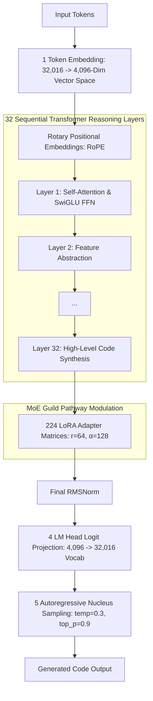

# The 7-Billion Parameter Neural "Thinking" Process

> How **6.74 billion weights**, **1,024 attention heads**, and **224 LoRA expert pathways** process, reason, and generate code through dense high-dimensional tensor operations.

---

## Cognitive Processing Pipeline

---

## 4-Stage Neural Calculation Dynamics

### 1. High-Dimensional Embedding (Token → 4,096-Dim Vector Space)
- **Weight Matrix**: `embed_tokens` ($32,016 \times 4096 = 131,137,536$ parameters).
- Input token IDs are mapped to dense 4,096-dimensional vectors.
- Rotary Positional Embedding (RoPE) rotates vector pairs to preserve relative distances across multi-line code structures.

---

### 2. Multi-Head Self-Attention (1,024 Attention Heads)
Each layer contains **32 Attention Heads** ($32 \text{ layers} \times 32 \text{ heads} = \mathbf{1,024} \text{ total heads}$):

- **Query, Key, Value, Output Projections**:
  $$Q = X W_Q, \quad K = X W_K, \quad V = X W_V$$
  - `q_proj`, `k_proj`, `v_proj`, `o_proj`: Each $4096 \times 4096 = 16,777,216$ weights per layer.

- **Scaled Dot-Product Attention Equation**:
  $$\text{Attention}(Q, K, V) = \text{softmax}\left(\frac{Q K^T}{\sqrt{d_k}}\right) V$$
- Heads specialize dynamically: some track variable declarations, some monitor scope boundaries, and others manage import contracts.

---

### 3. SwiGLU Non-Linear Feature Expansion (FFN — 11,008-Dim Intermediate Space)
- **Intermediate Dimension**: $11,008$
- **Weight Projections per Layer**:
  - `gate_proj`: $(4096, 11008) = 45,088,768$ weights.
  - `up_proj`: $(4096, 11008) = 45,088,768$ weights.
  - `down_proj`: $(11008, 4096) = 45,088,768$ weights.

- **SwiGLU Activation Function**:
  $$\text{SwiGLU}(X) = \left( \text{SiLU}(X W_{\text{gate}}) \odot X W_{\text{up}} \right) W_{\text{down}}$$
  where $\text{SiLU}(x) = x \cdot \sigma(x)$.
- This expands representation 2.68× into an 11,008-dim space, performing complex non-linear feature synthesis (resolving variable scope, logic loops, type bounds).

---

### 4. MoE Guild Modulation via QLoRA Pathways
- For the active guild (e.g. `debugger`, `security`, `webgl`, `api`), 160M LoRA adapter weights modulate the layer activations:
  $$W_{\text{effective}} = W_{\text{base}} + \left(B_{\text{guild}} \cdot A_{\text{guild}}\right) \times 2.0$$
- Channels base model representations into domain-specific expert solutions.

---

## Compute Matrix per Forward Pass

| Metric | Formula | Value |
|--------|---------|-------|
| **Base Parameters** | Total weight counts | **6,738,415,616** (~6.74B) |
| **LoRA Adapters** | 224 matrices ($r=64$) | **159,907,840** (~160M) |
| **FLOPs per Token** | $2 \times N_{\text{params}}$ | **13.48 GFLOPs / token** |
| **2,048 Sequence FLOPs** | $13.48 \times 2048$ | **~27.6 Trillion FLOPs** |
| **VRAM Memory** | 4-bit NF4 Quantization | **~4.0 GB (Metal GPU)** |

---

## Related Notes

- Architecture Overview: [[01-Brain-Architecture/00-Brain-Overview|00-Brain-Overview]]
- Core Generator Subsystem: [[01-Brain-Architecture/03-Core-LLM-Generator|03-Core-LLM-Generator]]
- QLoRA Fine-Tuning: [[04-Experiments/QLoRA-FineTuning|QLoRA-FineTuning]]
- Master Dashboard: [[00-Dashboard/Dashboard|Dashboard]]
