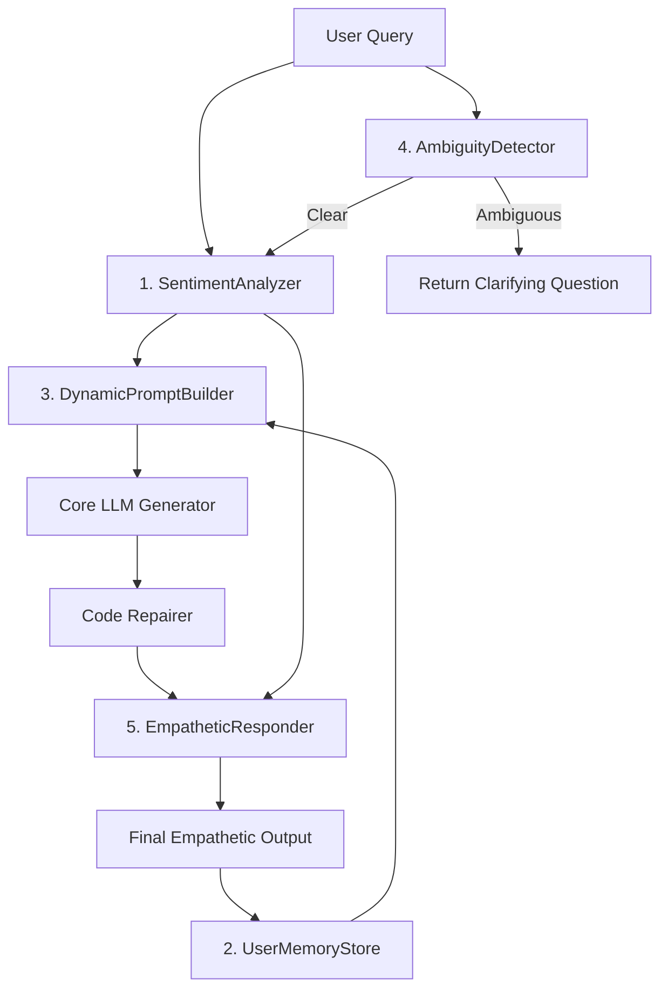

# Subsystem 6: Social Intelligence

> Human-like social awareness layer providing empathetic, personalized interactions through sentiment analysis, user memory, dynamic prompt construction, ambiguity detection, and empathetic response wrapping.

---

## Overview

The **Social Intelligence** subsystem adds a sixth processing layer to the cognitive pipeline. It operates at two insertion points:

1. **Pre-generation** (before LLM runs): Detects sentiment, checks for ambiguity, builds a context-aware system prompt incorporating user profile and emotional state.
2. **Post-generation** (after code repair): Wraps the output with empathetic, human-like messages adapted to the user's detected mood.

- **File Source**: [`src/brain/social.py`](file:///Users/ms/Desktop/CONCODE_BRAIN/src/brain/social.py)
- **Data Files**:
  - [`data/empathy_templates.yaml`](file:///Users/ms/Desktop/CONCODE_BRAIN/data/empathy_templates.yaml) -- 8 template categories, 40+ phrases
  - [`data/clarifying_questions.yaml`](file:///Users/ms/Desktop/CONCODE_BRAIN/data/clarifying_questions.yaml) -- 25+ ambiguous query patterns with tailored questions
  - [`data/user_profiles.json`](file:///Users/ms/Desktop/CONCODE_BRAIN/data/user_profiles.json) -- Persistent user profile store (auto-generated)

---

## 5-Component Architecture



---

## Component Details

### 1. SentimentAnalyzer

| Property | Value |
|----------|-------|
| **Model** | DistilBERT fine-tuned on SST-2 |
| **Output Classes** | `positive`, `neutral`, `negative`, `confused` |
| **Fallback** | Rule-based keyword counting |

Maps the SST-2 binary (POSITIVE/NEGATIVE) output to 4 classes via confidence thresholds:

```
POSITIVE >= 0.85  ->  positive
POSITIVE 0.55-0.85  ->  neutral
NEGATIVE >= 0.70  ->  negative
NEGATIVE 0.50-0.70  ->  confused
```

Additionally runs regex-based confusion and frustration pattern detectors that override the model output when triggered.

### 2. UserMemoryStore

| Property | Value |
|----------|-------|
| **Storage** | JSON file on disk |
| **Profile Fields** | name, tone, past_interactions (10), favorite_topics, common_errors (20), sentiment_history (20) |
| **Persistence** | Auto-saves after every interaction |

Tracks per-session user profiles including:
- Interaction history (last 10 query/response pairs)
- Guild activation frequency (favorite topics)
- Common error patterns (when repair is applied)
- Sentiment history (rolling window of 20)
- Auto-detected tone preference (casual vs formal)

### 3. DynamicPromptBuilder

| Property | Value |
|----------|-------|
| **Token Budget** | ~450 tokens |
| **Inputs** | Guild base prompt + sentiment + user profile + conversation history |

Replaces static guild system prompts with context-aware compositions that incorporate:
- Tone adaptation (casual vs formal language)
- User personalization (name, experience level)
- Sentiment-adaptive instructions (empathetic for frustrated users, step-by-step for confused users)
- Topic awareness (frequent guild activations)
- Error-prone user awareness (extra syntax attention)
- Conversation continuity summaries

### 4. AmbiguityDetector

| Property | Value |
|----------|-------|
| **Detection Layers** | Pattern matching + heuristic rules |
| **Patterns** | 25+ known ambiguous query forms |
| **Bypass** | Skipped when conversation history exists (follow-up queries) |

Intercepts vague queries (e.g., "fix this", "add authentication", "make it faster") and returns domain-specific clarifying questions instead of generating uncertain code.

### 5. EmpatheticResponder

| Property | Value |
|----------|-------|
| **Template Categories** | 8 (frustration, confusion, success, apology, encouragement, greeting, repair_notice, neutral) |
| **Phrase Count** | 40+ variants |
| **Selection** | Random per-interaction for natural variation |

Wraps generated code with human-like messages adapted to the detected sentiment. Frustrated users receive encouraging preambles; confused users get explanatory introductions.

---

## Related Notes

- Architecture Overview: [[00-Brain-Overview]]
- Neural Thinking Process: [[08-Neural-Thinking-Process]]
- Session Memory: [[05-Session-Memory]]
- FastAPI Service: [[06-FastAPI-Service]]
- Thinking Skill 51: [[07-Thinking-Skills/51-Sentiment-Classification-Threshold-Mapping|51-Sentiment-Classification-Threshold-Mapping]]
- Thinking Skill 52: [[07-Thinking-Skills/52-User-Profile-Persistence-And-Tone-Detection|52-User-Profile-Persistence-And-Tone-Detection]]
- Thinking Skill 53: [[07-Thinking-Skills/53-Dynamic-System-Prompt-Composition|53-Dynamic-System-Prompt-Composition]]
- Thinking Skill 54: [[07-Thinking-Skills/54-Ambiguity-Detection-And-Clarification|54-Ambiguity-Detection-And-Clarification]]
- Thinking Skill 55: [[07-Thinking-Skills/55-Empathetic-Response-Wrapping|55-Empathetic-Response-Wrapping]]
