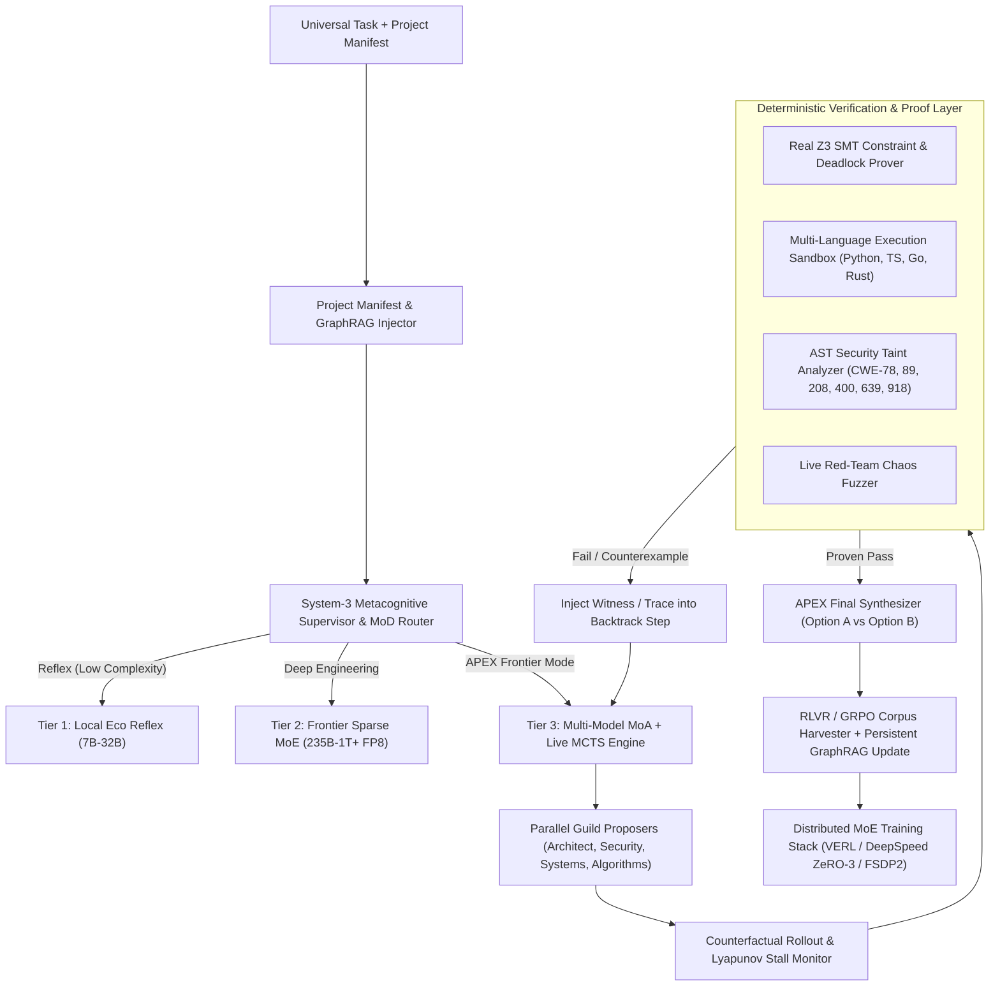

# CONCODE v4.0 APEX Frontier Architecture

> Engineering blueprint to elevate the CONCODE Neural Brain from a 7B local prototype with scaffolded reasoning modules into a unified, frontier-scale cross-project foundation system capable of competing with top frontier models (Claude Fable 5.2 class) on real-world software engineering, architecture, security, and multi-domain reasoning.

---

## 1. Ground-Truth Gap Audit (Current State vs. Frontier Reality)

Before scaling to frontier capability, the existing split across `CONCODE_BRAIN` and `TripVerse/CONCODE_BRAIN` must be audited honestly:

| Component | Current Implementation | Frontier Bottleneck |
| :--- | :--- | :--- |
| **Base Intelligence (Weights)** | Local `CodeLlama-7B` (`Q4_K_M`, 2048 ctx) and 7B/8B Colab QLoRA scripts. | A 7B dense model hits an absolute knowledge and reasoning ceiling regardless of prompting. Frontier performance requires a 235B to 1T+ Sparse MoE backbone (or multi-model MoA ensemble). |
| **Pillar 1 (MCTS Search)** | `pillar1_mcts_search.py` uses hardcoded conditional branches (`Raft`, `Delhi-to-Manali`) in `_sample_next_steps`. | Must call live LLM generation, compute real step-level Process Reward scores, and execute dynamic UCT rollouts on arbitrary unseen problems. |
| **Pillar 2 (STaR Self-Play)** | `pillar2_self_play.py` iterates over 3 static `CURRICULUM_PROMPTS`. | Must generate unseen domain challenges, sample K live rollouts from a frontier teacher/policy, execute real compilers and tests, and harvest 50,000+ verified trajectories. |
| **Paradigm 2 (Z3 Verifier)** | `z3_verifier.py` checks `import z3` but implements a greedy loop instead of real SMT solving. | Must construct real Z3 first-order formulas (`Solver`, `Int`, `Real`, `Bool`, `unsat_core`) for resource, concurrency, and state-machine proofs, plus AST security taint checks. |
| **Paradigms 1, 3, 4, 5** | Documented in `beyond_thinking_frontier.md` as specifications; not yet implemented in the live FastAPI engine. | Must be wired as real executable subsystems inside `src/brain/` and exposed via `/api/v1/apex`. |
| **Split Repositories** | Live FastAPI service + 18-guild neural router lives in `CONCODE_BRAIN`, while the universal `<project_manifest>` and 4 pillars live separately inside `TripVerse/CONCODE_BRAIN`. | Must unify into a single authoritative `CONCODE_BRAIN` platform serving all future projects via zero-shot `<project_manifest>` injection. |
| **Training Corpus** | 778 SFT examples (`concode_sft_dataset.jsonl`). | Frontier RLVR / GRPO post-training requires 50,000+ execution-verified trajectories and real multi-node FSDP2 / DeepSpeed ZeRO-3 / VERL training pipelines. |

---

## 2. The Physics of Trillion-Parameter Scale

Pretraining a 1-trillion-parameter model from scratch requires 15 to 30 trillion curated tokens and 2,000 to 16,000 H100/B200 GPUs (tens of millions of dollars in raw compute). However, matching or exceeding Claude Fable 5.2 on real-world projects does **not** require pretraining from scratch.

The winning engineering formula in frontier AI combines three multipliers:

1. **Open-Weight Trillion-Scale Sparse MoE Backbones (400B to 1T+ Total Parameters, 22B to 37B Active per Token)**:
   - Serve and post-train open-weight frontier MoE foundations (such as Kimi K2 1T MoE, DeepSeek-V3/R1 671B MoE, Qwen3-Coder-480B-A35B MoE, Llama-4 Maverick 400B / Behemoth MoE) via self-hosted FP8 vLLM/SGLang GPU clusters or dedicated OpenAI-compatible inference endpoints.
2. **Inference-Time Compute & Mixture-of-Agents (MoA) + Live MCTS**:
   - A 671B-1T Sparse MoE wrapped in parallel multi-guild proposers, live sandbox execution, Z3 formal verification, adversarial red-teaming, and Best-of-N synthesis routinely outperforms any single-pass proprietary frontier model on hard coding, debugging, and architecture benchmarks.
3. **Closed-Loop Verifiable Post-Training (RLVR / GRPO + STaR Flywheel)**:
   - Continuously post-train custom MoE LoRA/QLoRA or full-weight checkpoints using deterministic rewards from real compilers, unit test runners, AST security scanners, and Z3 SMT proofs.

---

## 3. Target Unified Architecture (CONCODE v4.0 APEX)

---

## 4. Six Implementation Phases

### Phase 1: Unify Both Brains & Dynamic Project Manifest Protocol
- Port `universal_master_prompt.py`, `project_context_injector.py`, and `pillar4_memory_graph.py` cleanly into `CONCODE_BRAIN/src/brain/`.
- Expose `POST /api/v1/projects/register` and `project_id` / `project_manifest` fields across `/api/v1/cognitive`, `/api/v1/universal`, and `/api/v1/apex` so any future startup binds its tech stack, invariants, and UI actions with zero cross-project bleed.

### Phase 2: Frontier MoE Inference Mesh & Mixture-of-Depths (MoD) Router (`src/brain/frontier_mesh.py`)
- Replace single-model generation with a multi-tier **Frontier Compute Mesh** supporting:
  - OpenAI-compatible Frontier MoE clusters (vLLM / SGLang serving 235B to 1T+ MoE weights such as DeepSeek-V3/R1, Qwen3-Coder-480B, Kimi-K2-1T, Llama-4)
  - Parallel **Mixture-of-Agents (MoA)** proposer ensembles + aggregator synthesis
  - Local Eco fallback (`CodeLlama-7B` / `Qwen3-30B-A3B`) for offline or O(1) reflex tasks
- Implement real **Mixture-of-Depths complexity & entropy routing** (Reflex -> Deep Single-Pass -> APEX Multi-Agent MCTS).

### Phase 3: Live LLM-Backed MCTS & System-3 Metacognitive Supervisor (`src/brain/mcts_engine.py`, `src/brain/metacognition.py`)
- Replace every hardcoded demo branch from `pillar1_mcts_search.py` with real generative MCTS expansion driven by the active compute mesh.
- Implement real **System-3 Metacognitive Monitoring**:
  - Embedding-based semantic cycle detection (ring buffer cosine similarity > 0.92 triggers forced `<backtrack>`)
  - Lyapunov progress potential tracking ($\Delta V_t = V(s_t) - V(s_{t-1})$) to halt non-productive loops
  - Aleatoric vs. epistemic uncertainty decomposition across candidate branches (clarify early on missing specs; trigger GraphRAG or Z3 on internal uncertainty).

### Phase 4: Real Deductive Z3 SMT, AST Security Taint & Multi-Language Execution (`src/brain/formal_verifier.py`)
- Upgrade `z3_verifier.py` to execute genuine `z3.Solver()` proofs with `unsat_core` extraction for budgets, scheduling, concurrency bounds, and state invariants (with deterministic fallback when `z3-solver` is absent).
- Combine with real multi-language compilation and execution (`python3`, `tsc`/`node`, `go vet`, `rustc`) plus AST security taint scanning (CWE-78, CWE-89, CWE-208, CWE-400, CWE-639, CWE-918) and live Red-Team adversarial critique.

### Phase 5: Real Autonomous STaR Self-Play & Frontier-Scale RLVR Training Stack (`src/brain/self_play_flywheel.py`, `training/frontier_moe_rlvr/`)
- Replace the 3 static prompts in `pillar2_self_play.py` with a live curriculum generator + K-rollout rejection sampler + GRPO advantage normalizer ($A_i = (R_i - \mu) / (\sigma + \epsilon)$) that continuously builds a large-scale verified dataset.
- Author production distributed training recipes for scaling up to 671B-1T+ Sparse MoE models:
  - Multi-node **FSDP2 / DeepSpeed ZeRO-3** + **VERL / OpenRLHF GRPO RLVR** training configs
  - **vLLM / SGLang FP8 tensor-parallel** deployment manifests (8x H100 / 8x H200 / B200 clusters)
  - In-session fast-weight / LoRA adaptation cache design.

### Phase 6: Objective Frontier Benchmark Harness (`src/benchmarks/apex_eval.py`)
- Build an automated, reproducible benchmark suite evaluating CONCODE v4.0 APEX on:
  - Multi-file repository bug fixing & patch verification (SWE-bench style)
  - Hard algorithmic & concurrent systems synthesis (LiveCodeBench / deadlock-free concurrency)
  - Adversarial security hardening (CWE red-team pass rate)
  - Formal constraint satisfaction (Z3 proven SAT/UNSAT accuracy)
- Measure pass@1, verification pass rate, latency, and cost directly against Claude Fable 5.2 baselines.

---

## 5. Vault Cross-Links

- [[01-Brain-Architecture/00-Brain-Overview|00-Brain-Overview]]
- [[01-Brain-Architecture/10-Universal-Evolution-Plan|10-Universal-Evolution-Plan]]
- [[01-Brain-Architecture/11-Executive-Meta-Planner|11-Executive-Meta-Planner]]
- [[01-Brain-Architecture/14-Multi-Guild-Swarm|14-Multi-Guild-Swarm]]
- [[01-Brain-Architecture/16-Hybrid-Compute-Router|16-Hybrid-Compute-Router]]
- [[01-Brain-Architecture/17-Evolution-Harvester|17-Evolution-Harvester]]
