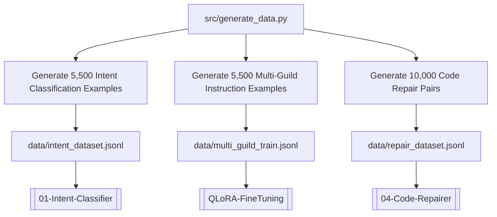

# Synthetic Data Generation Pipeline

> Python dataset generator (`src/generate_data.py`) synthesizing 21,000+ training pairs across 3 core datasets.

---

## Overview

The **Data Pipeline** script is responsible for generating fine-tuning and training datasets for all neural subsystems in the CONCODE Neural Brain.

- **File Source**: [`src/generate_data.py`](file:///Users/ms/Desktop/CONCODE_BRAIN/src/generate_data.py)
- **Output Directory**: [`data/`](file:///Users/ms/Desktop/CONCODE_BRAIN/data)
- **Total Synthetic Volume**: ~21,000 generated training examples (~8.0 MB JSONL data).

---

## Generated Datasets & Schemas

---

## Dataset Specifications

| Dataset File | Targeted Subsystem | Record Count | Format | File Note Link |
|--------------|-------------------|--------------|--------|----------------|
| `intent_dataset.jsonl` | [[01-Intent-Classifier]] | 5,500 | `{"text": "...", "label": "..."}` | [[Intent-Dataset]] |
| `multi_guild_train.jsonl` | [[03-Core-LLM-Generator]] | 5,500 | `{"system": "...", "instruction": "...", "output": "..."}` | [[Multi-Guild-Train]] |
| `repair_dataset.jsonl` | [[04-Code-Repairer]] | 10,000 | `{"broken": "...", "fixed": "..."}` | [[Repair-Dataset]] |

---

## Related Notes

- Intent Dataset: [[Intent-Dataset]]
- Instruction Fine-Tuning Data: [[Multi-Guild-Train]]
- Code Repair Data: [[Repair-Dataset]]
- QLoRA Fine-Tuning: [[QLoRA-FineTuning]]
