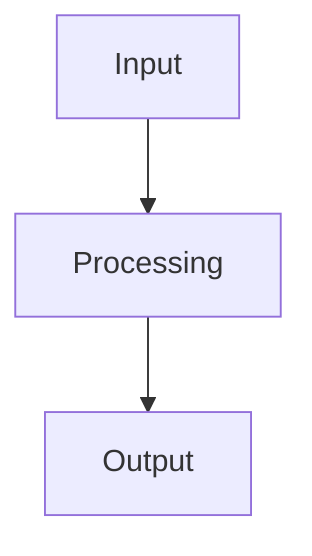

# Subsystem {{number}}: {{name}}

> High-level summary of subsystem functionality.

---

## Overview

Description of subsystem purpose and architecture.

---

## Workflow

---

## Related Notes

- Brain Overview: [[00-Brain-Overview]]
- Master Dashboard: [[Dashboard]]
