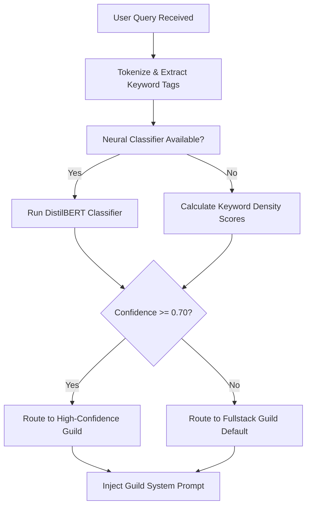

# Decision Graph: Query Guild Routing

> Logical decision tree determining how user prompts are routed to 1 of 13 expert guilds.

---

## Flowchart Graph

---

## Related Notes

- MOC: [[08-Decision-Graphs/Decision-Graphs-MOC|Decision-Graphs-MOC]]
- Subsystem: [[01-Brain-Architecture/01-Intent-Classifier|01-Intent-Classifier]]
