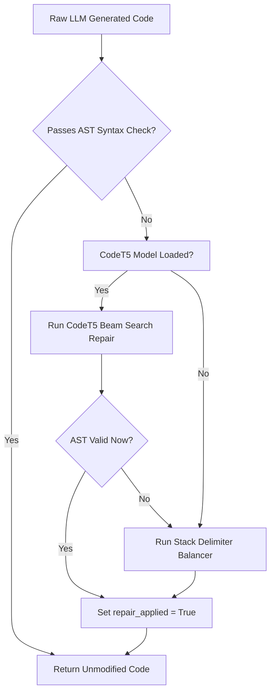

# Decision Graph: Code Repair Fallbacks

> Decision tree governing sequential code repair passes across CodeT5 and regex heuristics.

---

## Flowchart Graph

---

## Related Notes

- MOC: [[08-Decision-Graphs/Decision-Graphs-MOC|Decision-Graphs-MOC]]
- Subsystem: [[01-Brain-Architecture/04-Code-Repairer|04-Code-Repairer]]
