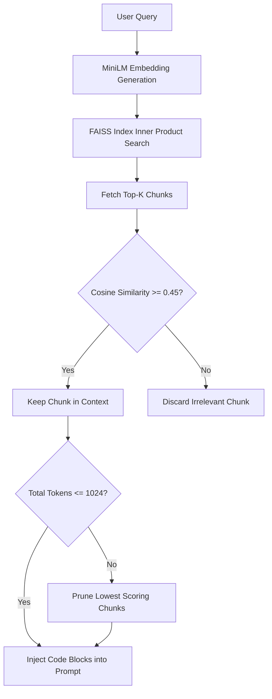

# Decision Graph: Retrieval Relevance Filter

> Decision pipeline evaluating workspace code context relevance before injecting into generator prompt.

---

## Flowchart Graph

---

## Related Notes

- MOC: [[08-Decision-Graphs/Decision-Graphs-MOC|Decision-Graphs-MOC]]
- Subsystem: [[01-Brain-Architecture/02-Workspace-Retriever|02-Workspace-Retriever]]
