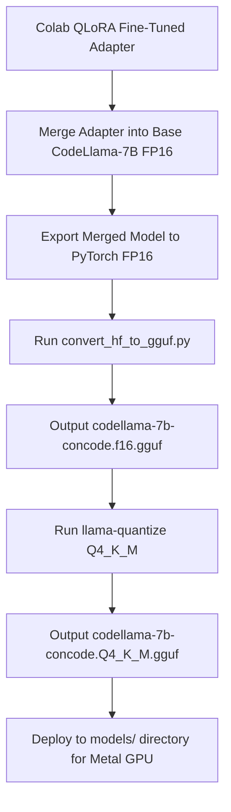

# Decision Graph: Model Quantization Pipeline

> Process graph for converting FP16 PyTorch model weights into Metal GPU-optimized GGUF files.

---

## Flowchart Graph

---

## Related Notes

- MOC: [[08-Decision-Graphs/Decision-Graphs-MOC|Decision-Graphs-MOC]]
- Quantization Experiment: [[04-Experiments/GGUF-Quantization|GGUF-Quantization]]
