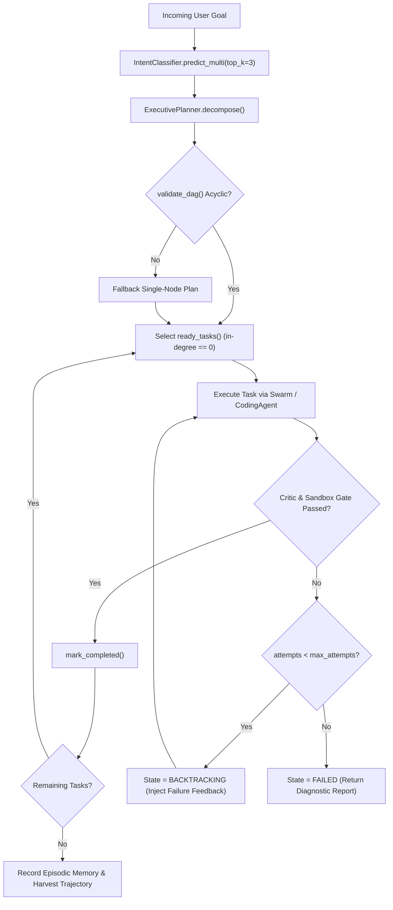

# Decision Graph: Universal DAG Planner & Backtracking

---

## Related Notes

- Decision Graphs MOC: [[08-Decision-Graphs/Decision-Graphs-MOC|Decision-Graphs-MOC]]
- Planner Subsystem: [[01-Brain-Architecture/11-Executive-Meta-Planner|11-Executive-Meta-Planner]]
