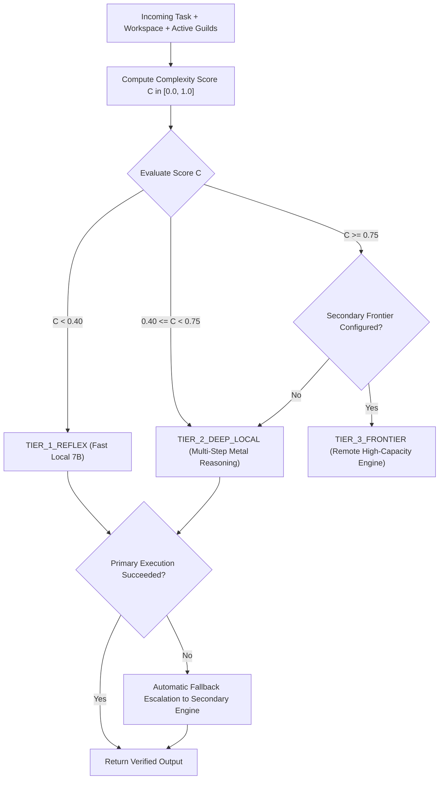

# Decision Graph: 3-Tier Hybrid Compute Router

---

## Related Notes

- Decision Graphs MOC: [[08-Decision-Graphs/Decision-Graphs-MOC|Decision-Graphs-MOC]]
- Router Subsystem: [[01-Brain-Architecture/16-Hybrid-Compute-Router|16-Hybrid-Compute-Router]]
