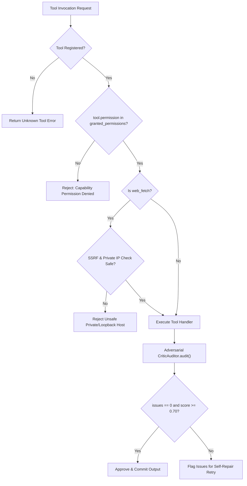

# Decision Graph: Capability-Gated Tool Bus & Critic Audit

---

## Related Notes

- Decision Graphs MOC: [[08-Decision-Graphs/Decision-Graphs-MOC|Decision-Graphs-MOC]]
- Tool Bus Subsystem: [[01-Brain-Architecture/13-Universal-Tool-Bus|13-Universal-Tool-Bus]]
- Swarm Subsystem: [[01-Brain-Architecture/14-Multi-Guild-Swarm|14-Multi-Guild-Swarm]]
